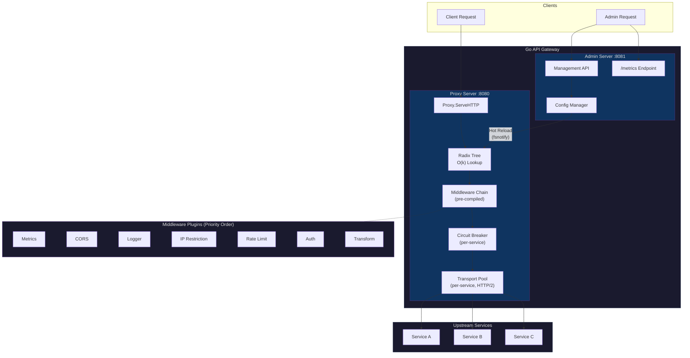
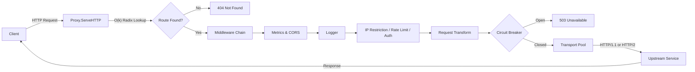
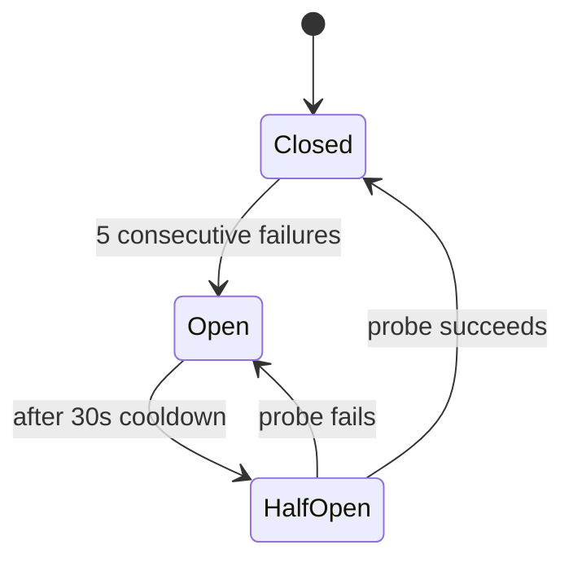

# Go API Gateway

A lightweight, high-performance API Gateway written in Go. Designed for production workloads with zero-allocation routing, per-service circuit breakers, and hot-reload configuration.

## Architecture



### Request Flow



### Circuit Breaker State Machine



### Config Hierarchy & Plugin Execution Order

Plugins are resolved by specificity (`Route` overrides `Service`, which overrides `Global`):

```
Global Plugins → Service Plugins → Route Plugins
   (lowest)         (middle)         (highest priority)
```

Once merged, enabled plugins are pre-compiled in deterministic execution order:
1. `metrics` / `prometheus` (Priority `0`)
2. `cors` (Priority `1`)
3. `logger` / `logging` (Priority `2`)
4. `ip-restriction` / `bot-detection` (Priority `3`)
5. `rate-limiting` (Priority `4`)
6. `authorization` (Priority `5`)
7. `request-transform` / `request-transformation` (Priority `6`)

## Features

| Feature | Description |
|---------|-------------|
| **Radix Tree Routing** | Zero-allocation O(k) path lookup with param (`:id`) and wildcard (`*path`) support |
| **Circuit Breaker** | Lock-free fast path, per-service state machine (Closed → Open → HalfOpen) |
| **Connection Pooling** | Per-service HTTP transport with configurable pool sizes and HTTP/2 support |
| **Plugin System** | Composable middleware — pre-compiled at config load, zero alloc per-request |
| **Built-in Plugins** | CORS, In-Memory Metrics (Prometheus/JSON), IP Restriction & Bot Detection, Request/Response Transform, JWT Auth, Rate Limiting, Structured Logging |
| **Hot Reload** | Config changes via fsnotify trigger atomic route table swap (no downtime) |
| **Management API** | Full CRUD REST API for upstreams, services, routes, CORS, and plugins |
| **Duplicate Detection** | Route conflict validation at config, management API, and radix tree layers |

## Project Structure

```
go-api-gateway/
├── cmd/api-gateway/              # Application entry point
├── configs/config.yaml           # Gateway configuration
├── docs/specs/                   # Feature specifications (e.g. Redis rate limiting)
├── internal/
│   ├── config/                   # Config manager, CRUD, hot-reload (fsnotify)
│   │   ├── config.go             # Struct definitions (Upstream, Service, Route)
│   │   ├── loader.go             # YAML loading & file watcher
│   │   ├── route.go              # Route CRUD with conflict detection
│   │   └── *_test.go             # Unit & concurrency race tests
│   ├── gateway/                  # Core gateway engine
│   │   ├── proxy.go              # HTTP handler (ServeHTTP), atomic route snapshot
│   │   ├── radix.go              # Radix tree: Insert, Search, wildcard, params
│   │   ├── routing.go            # Route table builder, middleware chain compiler
│   │   ├── transport.go          # Per-service HTTP transport pool + circuit breaker wrapper
│   │   ├── circuit_breaker.go    # Thread-safe state machine (lock-free hot path)
│   │   ├── metrics.go            # Lock-free atomic in-memory metrics collector
│   │   ├── plugin.go             # Plugin registry and interface
│   │   ├── routes.go             # Admin Management API route definitions
│   │   └── server.go             # Dual-server bootstrap (proxy + admin)
│   ├── handler/                  # Management API handlers (REST CRUD)
│   ├── middleware/               # Built-in plugins
│   │   ├── auth.go               # JWT authentication
│   │   ├── cors.go               # Cross-Origin Resource Sharing (CORS)
│   │   ├── ip_restriction.go     # IP/CIDR allowlist, denylist, and bot User-Agent blocking
│   │   ├── logger.go             # Structured request logging (zerolog)
│   │   ├── metrics.go            # Request/latency metrics middleware
│   │   ├── ratelimit.go          # In-memory rate limiting
│   │   └── request_transform.go  # Request/response header & query transformation
│   ├── domain/                   # DTOs and request/response models
│   └── helper/                   # JSON response helpers
├── mock-server/                  # Mock upstream for testing
├── performance/                  # K6 load test scripts
├── Dockerfile                    # Multi-stage production build
└── docker-compose.yml            # Gateway + mock server + K6
```

## Quick Start

### Prerequisites

- Go 1.21+
- Docker & Docker Compose (optional)

### Run Locally

```bash
# Clone & install
git clone https://github.com/haiser1/go-api-gateway.git
cd go-api-gateway
go mod tidy

# Development (with hot reload)
make run-dev

# Production build
make build && make run
```

### Run with Docker

```bash
# Start gateway + mock server
docker compose up -d api-gateway mock-server

# View logs
docker compose logs -f api-gateway

# Stop
docker compose down
```

## Configuration

The gateway is configured via `configs/config.yaml`. Changes are detected automatically via fsnotify and applied without restart.

```yaml
server:
  proxy_port: 8080      # Public traffic
  admin_port: 8081      # Management API & /metrics
  log_level: info

global_plugins:
  - name: metrics
    enabled: true
    config:
      record_query: false
  - name: logger
    enabled: true
    config:
      format: json
  - name: cors
    enabled: true
    config:
      allowed_origins: ["*"]
      allowed_methods: ["GET", "POST", "PUT", "DELETE", "OPTIONS", "PATCH"]
      allowed_headers: ["Content-Type", "Authorization", "X-Requested-With"]
      exposed_headers: ["X-Request-Id"]
      allow_credentials: true
      max_age: 86400

upstreams:
  - id: upstream-backend
    name: backend-upstream
    algorithm: round-robin        # round-robin | least-conn | random
    targets:
      - host: backend-service
        port: 8000
        weight: 100
        health_check:
          path: /health
          interval: 10s

services:
  - id: svc-backend
    name: backend-service
    upstream_id: upstream-backend  # Links to upstream above
    protocol: http
    timeout: 30                   # Total request timeout (seconds)
    connect_timeout: 10           # TCP connection timeout
    read_timeout: 30              # Response header timeout
    retries: 3                    # Retry on failure
    retry_backoff: 1.5            # Exponential backoff multiplier
    plugins:
      - name: authorization
        enabled: true
        config:
          type: jwt
      - name: ip-restriction
        enabled: true
        config:
          allowed_ips: ["10.0.0.0/8", "192.168.1.0/24"]
          denied_ips: ["192.168.1.99"]
          blocked_bots: ["sqlmap", "nikto"]
          trust_forwarded_for: true

routes:
  - id: route-users
    name: user-api
    methods: [GET, POST, PUT, DELETE]
    paths:
      - /api/v1/users
      - /api/v1/users/:id
    service_id: svc-backend
    strip_prefix: false
    plugins:
      - name: rate-limiting
        enabled: true
        config:
          requests_per_minute: 100
      - name: request-transform
        enabled: true
        config:
          add_headers:
            X-Gateway-Source: "go-api-gateway"
          set_headers:
            X-Api-Version: "v1"
          remove_headers:
            - X-Internal-Secret
          add_query_params:
            source: "gateway"
          remove_query_params:
            - debug
          add_response_headers:
            X-Served-By: "go-api-gateway"
          remove_response_headers:
            - X-Powered-By
```

## Management API

REST API on the admin port (default `:8081`) for runtime configuration and observability.

### Upstreams

| Method | Endpoint | Description |
|--------|----------|-------------|
| `GET` | `/api/upstreams` | List all upstreams |
| `POST` | `/api/upstreams` | Create upstream |
| `GET` | `/api/upstreams/:id` | Get upstream details |
| `PUT` | `/api/upstreams/:id` | Update upstream |
| `DELETE` | `/api/upstreams/:id` | Delete upstream |

### Services

| Method | Endpoint | Description |
|--------|----------|-------------|
| `GET` | `/api/services` | List all services |
| `POST` | `/api/services` | Create service |
| `GET` | `/api/services/:id` | Get service + routes |
| `PUT` | `/api/services/:id` | Update service |
| `DELETE` | `/api/services/:id` | Delete service |
| `GET` | `/api/services/:id/circuit-breaker` | Get circuit breaker state & failure count |
| `POST` | `/api/services/:id/circuit-breaker/reset` | Reset circuit breaker back to `CLOSED` |

### Routes

| Method | Endpoint | Description |
|--------|----------|-------------|
| `GET` | `/api/routes` | List all routes |
| `POST` | `/api/routes` | Create route |
| `GET` | `/api/routes/:id` | Get route details |
| `PUT` | `/api/routes/:id` | Update route |
| `DELETE` | `/api/routes/:id` | Delete route |

### CORS Configuration

Dedicated typed endpoints for managing CORS at the Global, Service, or Route level:

| Method | Endpoint | Description |
|--------|----------|-------------|
| `GET` | `/api/config/cors` | Get global CORS config |
| `POST` | `/api/config/cors` | Create global CORS config |
| `PUT` | `/api/config/cors` | Update global CORS config |
| `DELETE` | `/api/config/cors` | Delete global CORS config |
| `GET` | `/api/services/:id/cors` | Get service CORS config |
| `POST` | `/api/services/:id/cors` | Create service CORS config |
| `PUT` | `/api/services/:id/cors` | Update service CORS config |
| `DELETE` | `/api/services/:id/cors` | Delete service CORS config |
| `GET` | `/api/routes/:id/cors` | Get route CORS config |
| `POST` | `/api/routes/:id/cors` | Create route CORS config |
| `PUT` | `/api/routes/:id/cors` | Update route CORS config |
| `DELETE` | `/api/routes/:id/cors` | Delete route CORS config |

#### Example CORS Payload (`POST` / `PUT`)

```json
{
  "enabled": true,
  "allowed_origins": ["https://app.example.com"],
  "allowed_methods": ["GET", "POST", "PUT", "DELETE", "OPTIONS"],
  "allowed_headers": ["Content-Type", "Authorization"],
  "exposed_headers": ["X-Request-Id"],
  "allow_credentials": true,
  "max_age": 86400
}
```

### IP Restriction & Bot Detection Configuration

Dedicated typed endpoints for managing IP/CIDR allowlists, denylists, and bot User-Agent patterns at the Global, Service, or Route level:

| Method | Endpoint | Description |
|--------|----------|-------------|
| `GET` | `/api/config/ip-restriction` | Get global IP restriction config |
| `POST` | `/api/config/ip-restriction` | Create global IP restriction config |
| `PUT` | `/api/config/ip-restriction` | Update global IP restriction config |
| `DELETE` | `/api/config/ip-restriction` | Delete global IP restriction config |
| `GET` | `/api/services/:id/ip-restriction` | Get service IP restriction config |
| `POST` | `/api/services/:id/ip-restriction` | Create service IP restriction config |
| `PUT` | `/api/services/:id/ip-restriction` | Update service IP restriction config |
| `DELETE` | `/api/services/:id/ip-restriction` | Delete service IP restriction config |
| `GET` | `/api/routes/:id/ip-restriction` | Get route IP restriction config |
| `POST` | `/api/routes/:id/ip-restriction` | Create route IP restriction config |
| `PUT` | `/api/routes/:id/ip-restriction` | Update route IP restriction config |
| `DELETE` | `/api/routes/:id/ip-restriction` | Delete route IP restriction config |

### Request Transformation Configuration

Dedicated typed endpoints for managing request/response header and query transformations at the Global, Service, or Route level:

| Method | Endpoint | Description |
|--------|----------|-------------|
| `GET` | `/api/config/request-transform` | Get global request transform config |
| `POST` | `/api/config/request-transform` | Create global request transform config |
| `PUT` | `/api/config/request-transform` | Update global request transform config |
| `DELETE` | `/api/config/request-transform` | Delete global request transform config |
| `GET` | `/api/services/:id/request-transform` | Get service request transform config |
| `POST` | `/api/services/:id/request-transform` | Create service request transform config |
| `PUT` | `/api/services/:id/request-transform` | Update service request transform config |
| `DELETE` | `/api/services/:id/request-transform` | Delete service request transform config |
| `GET` | `/api/routes/:id/request-transform` | Get route request transform config |
| `POST` | `/api/routes/:id/request-transform` | Create route request transform config |
| `PUT` | `/api/routes/:id/request-transform` | Update route request transform config |
| `DELETE` | `/api/routes/:id/request-transform` | Delete route request transform config |

### Plugins

| Method | Endpoint | Description |
|--------|----------|-------------|
| `GET` | `/api/global-plugins` | List global plugins |
| `POST` | `/api/global-plugins` | Add global plugin |
| `PUT` | `/api/global-plugins/:name` | Update global plugin |
| `DELETE` | `/api/global-plugins/:name` | Delete global plugin |
| `GET` | `/api/services/:id/plugins` | List service plugins |
| `POST` | `/api/services/:id/plugins` | Add plugin to service |
| `PUT` | `/api/services/:id/plugins/:name` | Update service plugin |
| `DELETE` | `/api/services/:id/plugins/:name` | Delete service plugin |
| `GET` | `/api/routes/:id/plugins` | List route plugins |
| `POST` | `/api/routes/:id/plugins` | Add plugin to route |
| `PUT` | `/api/routes/:id/plugins/:name` | Update route plugin |
| `DELETE` | `/api/routes/:id/plugins/:name` | Delete route plugin |

### Gateway Status, Config & Metrics

| Method | Endpoint | Description |
|--------|----------|-------------|
| `GET` | `/api/status` | Gateway health, uptime, entity counts, and circuit breaker states |
| `GET` | `/api/health` | Alias for `/api/status` |
| `GET` | `/api/config` | Full running gateway configuration snapshot |
| `GET` | `/metrics` | Prometheus text exposition format (or JSON with `?format=json`) |
| `GET` | `/api/metrics` | Alias for `/metrics` on the Admin server |
| `POST` | `/api/metrics/reset` | Reset all in-memory metrics counters |

## Performance

The gateway is designed for high throughput with minimal overhead:

| Component | Performance |
|-----------|------------|
| Static route lookup | ~91–153 ns/op, **0 allocs** |
| Parameterized route lookup | ~377–461 ns/op, 2 allocs |
| Wildcard route lookup | ~338–440 ns/op, 2 allocs |
| Circuit breaker (hot path) | Lock-free atomic check |
| Transport pool | 500 idle conns, 100/host, HTTP/2 enabled |

```bash
# Run benchmarks
go test -run=^$ -bench=. -benchmem ./internal/gateway/

# Run K6 load test
make k6-test
```

## Makefile Commands

```bash
make run-dev       # Development mode (go run)
make build         # Build production binary
make run           # Run production binary
make test          # Run all tests

make docker-up     # Start containers
make docker-down   # Stop containers
make docker-build  # Rebuild images
make docker-logs   # Tail container logs
make docker-stats  # Container resource usage
make docker-ps     # Container status
make docker-clean  # Prune unused resources

make k6-test       # Run K6 load tests
make log-analytics # Log level analytics
```

## Roadmap

- [x] **CORS Plugin** — Configurable cross-origin headers with Global/Service/Route CRUD API
- [x] **Prometheus / In-Memory Metrics** — Built-in `/metrics` endpoint (Prometheus & JSON formats)
- [x] **Request Transformation** — Request/response header and query parameter modification plugin
- [x] **IP Restriction & Bot Detection** — IP/CIDR allowlist, denylist, and User-Agent filtering
- [ ] **Redis Rate Limiting** — Distributed rate limiting for cluster environments ([Feature Spec](docs/specs/redis-rate-limiting.md))
- [ ] **gRPC Support** — gRPC proxying and protocol translation
- [ ] **WebSocket Support** — Persistent WebSocket connection proxying
- [ ] **Service Discovery** — Consul / etcd integration for dynamic registration
- [ ] **Advanced Load Balancing** — Least connections, weighted round-robin strategies

## License

MIT License — see [LICENSE](LICENSE)
