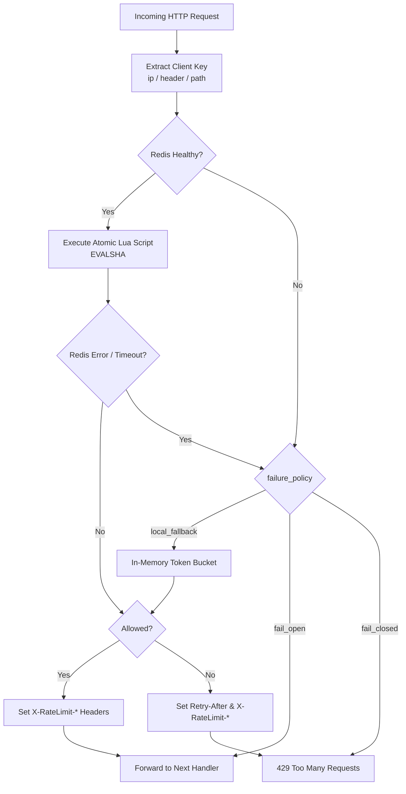

# Feature Specification: Distributed Redis Rate Limiting (`redis-rate-limiting`)

- **Status**: Draft / Planned
- **Target Component**: `internal/middleware/redis_ratelimit.go`, `internal/config/config.go`
- **Plugin Name**: `redis-rate-limiting` (or `rate-limiting` with `strategy: "redis"`)

---

## 1. Overview & Motivation

The current `rate-limiting` plugin (`internal/middleware/ratelimit.go`) stores counters in a per-route in-memory map (`map[string]int`) protected by a `sync.Mutex` and reset every 60 seconds via a background `time.Ticker`.

While suitable for single-instance deployments, in-memory rate limiting has two limitations in clustered production environments:
1. **No state sharing across gateway replicas**: If `N` gateway instances sit behind a load balancer, a client can send `N × requests_per_minute` before being throttled.
2. **Fixed-window boundary bursts**: Resetting the entire map every minute allows up to `2 × limit` requests across the boundary of two consecutive windows.

The `redis-rate-limiting` plugin will provide distributed, atomic rate limiting across all `go-api-gateway` instances using Redis Lua scripts, with automatic fallback to local in-memory limiting if Redis becomes unreachable.

---

## 2. Goals & Non-Goals

### Goals
- **Distributed state**: Enforce accurate rate limits across multiple gateway instances using Redis.
- **Atomic execution**: Use a pre-loaded Redis Lua script (`EVALSHA` with `EVAL` fallback) for single-round-trip sliding window or token bucket evaluation.
- **Fail-open / In-memory fallback**: Never take down the proxy data plane if Redis is slow or unavailable; degrade gracefully to local in-memory rate limiting or fail-open based on configuration.
- **Standard RateLimit headers**: Emit `X-RateLimit-Limit`, `X-RateLimit-Remaining`, `X-RateLimit-Reset`, and `Retry-After` headers.
- **Flexible key extraction**: Support rate limiting by Client IP (`ip`), Request Header (`header`, e.g., `X-API-Key`), or JWT Claim (`jwt_claim`).

### Non-Goals
- Multi-region active-active Redis synchronization (standard Redis standalone, Sentinel, or Cluster is sufficient).
- Per-request Redis connection creation (connections must be pooled globally per Redis endpoint).

---

## 3. Architecture & Request Flow



---

## 4. Configuration Schema

The plugin can be configured at the **Global**, **Service**, or **Route** level in `configs/config.yaml` or via the Management API (`:8081`).

### Example `configs/config.yaml`

```yaml
routes:
  - id: route-users
    name: user-api
    methods: [GET, POST]
    paths:
      - /api/v1/users
    service_id: svc-backend
    plugins:
      - name: redis-rate-limiting
        enabled: true
        config:
          redis_addr: "redis:6379"
          redis_password: ""
          redis_db: 0
          algorithm: "sliding_window"      # "sliding_window" | "token_bucket" | "fixed_window"
          requests_per_window: 100
          window_seconds: 60
          burst: 20                        # Used when algorithm == "token_bucket"
          key_by: "ip"                     # "ip" | "header"
          key_header: "X-API-Key"          # Required when key_by == "header"
          trust_forwarded_for: true
          timeout_ms: 15                   # Max Redis round-trip time before triggering fallback
          failure_policy: "local_fallback" # "local_fallback" | "fail_open" | "fail_closed"
          key_prefix: "gw:rl:"
```

### Configuration Fields

| Field | Type | Default | Description |
|-------|------|---------|-------------|
| `redis_addr` | `string` | `"localhost:6379"` | Redis `host:port` |
| `redis_password` | `string` | `""` | Optional Redis auth password |
| `redis_db` | `int` | `0` | Redis database number |
| `algorithm` | `string` | `"sliding_window"` | Rate limiting algorithm (`sliding_window`, `token_bucket`, `fixed_window`) |
| `requests_per_window` | `int` | `60` | Maximum allowed requests per window (backward-compatible with `requests_per_minute`) |
| `window_seconds` | `int` | `60` | Window duration in seconds |
| `burst` | `int` | `0` | Extra burst capacity for `token_bucket` |
| `key_by` | `string` | `"ip"` | Client identifier source (`ip`, `header`) |
| `key_header` | `string` | `""` | Header name when `key_by: "header"` (e.g., `X-API-Key`, `Authorization`) |
| `trust_forwarded_for` | `bool` | `false` | Extract client IP from `X-Forwarded-For` / `X-Real-IP` |
| `timeout_ms` | `int` | `15` | Per-request Redis command timeout in milliseconds |
| `failure_policy` | `string` | `"local_fallback"` | Behavior on Redis error (`local_fallback`, `fail_open`, `fail_closed`) |
| `key_prefix` | `string` | `"gw:rl:"` | Prefix for all Redis keys |

---

## 5. Redis Data Model & Atomic Lua Script

### Sliding Window Counter Approximation (O(1) Space & Time)

Instead of storing every timestamp in a `ZSET` (which consumes `O(N)` memory per user), use the **Sliding Window Counter** algorithm with two Redis keys per client/window or a single `HASH` key:

- Key format: `gw:rl:<route_or_scope>:<client_key>`
- Fields:
  - `curr_count`: Request count in current window
  - `prev_count`: Request count in previous window
  - `window_start`: Unix timestamp of current window start

```lua
-- KEYS[1]: rate limit hash key
-- ARGV[1]: limit
-- ARGV[2]: window size in seconds
-- ARGV[3]: current unix timestamp in seconds

local key = KEYS[1]
local limit = tonumber(ARGV[1])
local window = tonumber(ARGV[2])
local now = tonumber(ARGV[3])

local current_window = math.floor(now / window) * window
local data = redis.call("HMGET", key, "window_start", "curr_count", "prev_count")

local win_start = tonumber(data[1]) or current_window
local curr_count = tonumber(data[2]) or 0
local prev_count = tonumber(data[3]) or 0

if win_start < current_window then
    if win_start == current_window - window then
        prev_count = curr_count
    else
        prev_count = 0
    end
    curr_count = 0
    win_start = current_window
end

local elapsed = now - current_window
local weight = (window - elapsed) / window
local estimated = math.floor(prev_count * weight) + curr_count

if estimated >= limit then
    local reset_after = window - elapsed
    return {0, 0, reset_after}
end

curr_count = curr_count + 1
redis.call("HMSET", key, "window_start", win_start, "curr_count", curr_count, "prev_count", prev_count)
redis.call("EXPIRE", key, window * 2)

local remaining = math.max(0, limit - (estimated + 1))
local reset_after = window - elapsed
return {1, remaining, reset_after}
```

---

## 6. Response Headers & Status Code

Every request passing through the plugin receives:
- `X-RateLimit-Limit: <limit>`
- `X-RateLimit-Remaining: <remaining>`
- `X-RateLimit-Reset: <seconds_until_reset>`

When rate limit is exceeded (`allowed == 0`):
- `Retry-After: <seconds_until_reset>`
- HTTP Status: `429 Too Many Requests`
- Body: `{"error": "Rate limit exceeded"}`

---

## 7. Hot-Path & Concurrency Considerations

1. **Shared Redis Client Pool**:
   - Cache `*redis.Client` instances in a package-level `sync.Map` keyed by `redis_addr + db` so config reloads (`UpdateRoutes`) reuse existing TCP connection pools instead of leaking connections.
2. **Bound Latency with `context.WithTimeout`**:
   - Every Redis call must use `ctx, cancel := context.WithTimeout(r.Context(), timeout)` (default `15ms`) so a slow Redis server never stalls proxy worker goroutines.
3. **Priority Registration**:
   - Register `"redis-rate-limiting"` at priority `4` (same level as `"rate-limiting"`) in `internal/gateway/routing.go`.

---

## 8. Implementation Checklist

- [ ] Add `github.com/redis/go-redis/v9` to `go.mod`.
- [ ] Implement connection pool cache and Lua script runner in `internal/middleware/redis_ratelimit.go`.
- [ ] Register `"redis-rate-limiting"` in `init()` via `gateway.RegisterPlugin`.
- [ ] Add `"redis-rate-limiting": 4` to `pluginPriority` in `internal/gateway/routing.go`.
- [ ] Add unit tests in `internal/middleware/redis_ratelimit_test.go` using `miniredis` (or mock evaluator) covering:
  - Normal allow & 429 block with `X-RateLimit-*` headers
  - Sliding window rollover
  - Redis timeout triggering `local_fallback` and `fail_open`
- [ ] Add a `redis` service to `docker-compose.yml` for integration and k6 load testing.
